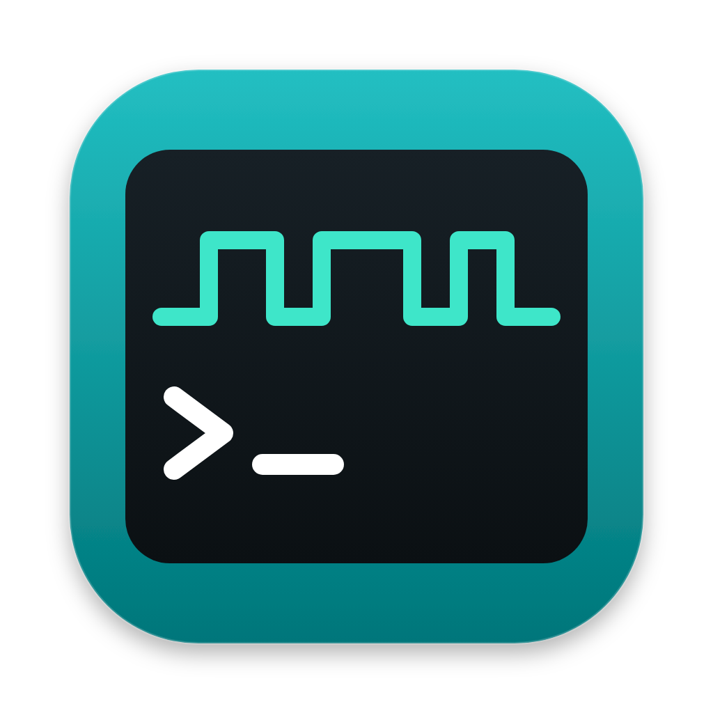
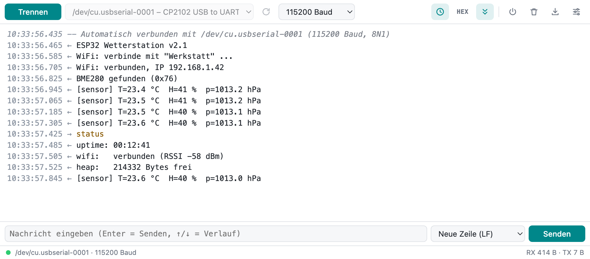
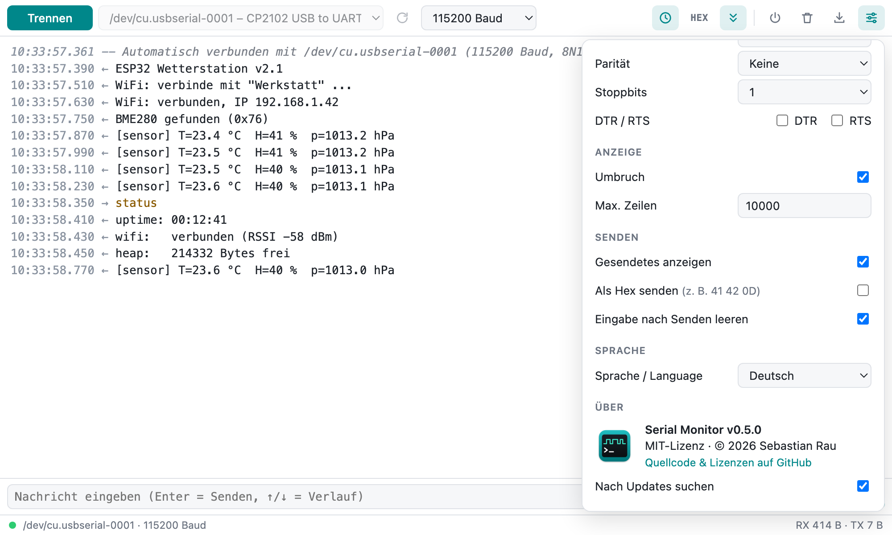
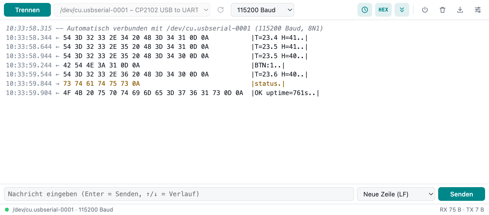

<p align="center">
  
</p>

<h1 align="center">Serial Monitor</h1>

<p align="center">
  Schlanker serieller Monitor für macOS, Windows und Linux – nach dem Vorbild des Arduino Serial Monitor.<br>
  <a href="README.md">English</a> · <b>Deutsch</b>
</p>

Gebaut mit Go und [Wails](https://wails.io). Die App nutzt den Webbrowser-Baustein des Betriebssystems,
statt einen eigenen Browser mitzuliefern. Deshalb sind die Pakete nur etwa 8 bis 11 MB groß.

<picture>
  <source media="(prefers-color-scheme: dark)" srcset="docs/screenshots/main-dark-de.png">
  
</picture>

## Funktionen

- Portliste mit echten Namen (`COM3`, `/dev/cu.usbserial-…`, `/dev/ttyUSB0`)
- Baudrate aus der Liste oder als eigener Wert
- Auto-Verbinden mit dem zuletzt genutzten Port, sobald er wieder da ist
- Kein Board-Neustart beim Verbinden; Board-Reset per Knopf (ESP32/ESP8266 über RTS, Arduino über DTR)
- Zeitstempel, Hex-Ansicht, Autoscroll, Ausgabe als Textdatei speichern
- Zeilenende beim Senden (keins, LF, CR, CR+LF), Senden als Hex, Verlauf mit ↑/↓
- Update-Prüfung mit direktem Download des passenden Pakets (abschaltbar)
- Oberfläche auf Deutsch und Englisch, helles und dunkles Design

## Screenshots

<table>
  <tr>
    <td width="50%">
      <picture>
        <source media="(prefers-color-scheme: dark)" srcset="docs/screenshots/settings-dark-de.png">
        
      </picture>
      <p align="center">Einstellungen</p>
    </td>
    <td width="50%">
      <picture>
        <source media="(prefers-color-scheme: dark)" srcset="docs/screenshots/hex-dark-de.png">
        
      </picture>
      <p align="center">Hex-Ansicht</p>
    </td>
  </tr>
</table>

## Download

Fertige Pakete gibt es unter **[Releases](https://github.com/sebastianrau/serial-monitor/releases)**:

| System  | Datei |
|---------|-------|
| macOS   | `SerialMonitor-<version>-mac.dmg` (Apple Silicon und Intel, ab macOS 13) |
| Windows | `SerialMonitor-<version>-windows-x64.exe` bzw. `-arm64.exe` (ohne Installation) |
| Linux   | `SerialMonitor-<version>-linux-amd64.tar.gz` bzw. `-arm64.tar.gz` |

Zu jedem Release gehören außerdem `THIRD_PARTY_LICENSES.txt` (Lizenzen der verwendeten Bibliotheken),
eine SBOM pro Betriebssystem im CycloneDX-Format (`*.sbom.cdx.json`) und `SHA256SUMS.txt`.

### Hinweise je System

- **macOS:** Die App ist nur ad hoc signiert, also weder mit einer Apple-Developer-ID signiert noch von Apple
  notarisiert. Deshalb blockiert macOS sie beim ersten Start. Freigeben unter
  *Systemeinstellungen > Datenschutz & Sicherheit > Dennoch öffnen* (ab macOS 15 reicht Rechtsklick > Öffnen nicht mehr).
  Alternativ im Terminal: `xattr -dr com.apple.quarantine "/Applications/Serial Monitor.app"`
- **Windows:** Braucht die WebView2-Laufzeit (unter Windows 10 und 11 vorinstalliert) und den Treiber
  für den USB-Seriell-Chip des Boards (z. B. CH340, CP210x). SmartScreen kann warnen, weil das Programm
  nicht signiert ist.
- **Linux:** Braucht `libwebkit2gtk-4.1` und Zugriff auf die Schnittstelle:
  `sudo usermod -aG dialout $USER`, danach neu anmelden.

## Bauen

Voraussetzung: Go (Version siehe `go.mod`). Node.js wird nicht benötigt.

```bash
./build.sh mac       # dist/Serial Monitor.app + .dmg (Apple Silicon und Intel)
./build.sh windows   # dist/SerialMonitor-<version>-windows-x64.exe und -arm64.exe (geht auch vom Mac aus)
./build.sh linux     # nur auf Linux, siehe unten
./build.sh all       # alles, was auf dem aktuellen System geht
```

Die Version kommt aus der Umgebungsvariable `VERSION` (Standard `1.0.0`), z. B. `VERSION=1.2.0 ./build.sh mac`.
Zum Entwickeln: `go run -tags desktop,production .`

Auf Linux (Debian/Ubuntu):

```bash
sudo apt install golang build-essential pkg-config libgtk-3-dev libwebkit2gtk-4.1-dev
./build.sh linux
```

## Releases

Ein Tag `v*` auf einem Commit aus `main` baut auf GitHub Actions alle Pakete und erstellt ein Release:

```bash
git tag v1.2.0
git push origin v1.2.0
```

Tags mit Bindestrich (z. B. `v1.3.0-beta.1`) und alle `0.x`-Versionen erscheinen als Vorabversion.
Die Release-Notizen kommen aus [CHANGELOG.md](CHANGELOG.md). Unter *Actions > Release > Run workflow*
lässt sich alles als Test bauen, ohne ein Release zu erstellen.

## Aufbau

- `main.go` – Fenster und App-Einrichtung
- `app.go` – serielle Schnittstelle (Ports auflisten, öffnen, lesen, schreiben, DTR/RTS, Board-Reset, Log speichern)
- `update.go` – Update-Prüfung über GitHub Releases
- `frontend/` – Oberfläche (`index.html`, `app.js`); läuft auch allein in Chrome oder Edge über die Web Serial API
- `frontend/i18n.js` – alle Texte auf Deutsch und Englisch
- `build/` – App-Icon (Quelle ist `icon.svg`)
- `build.sh` – Build-Skript; `scripts/licenses.sh` sammelt die Lizenzen der Bibliotheken, `scripts/winres`
  erzeugt Icon, Manifest und Versionsinfo für Windows
- `.github/workflows/release.yml` – Release-Workflow

Bekannte Einschränkung: Hardware-Flusskontrolle (RTS/CTS) wird von der Go-Bibliothek nicht unterstützt
und ist in der App ausgeblendet.

## Lizenz

[MIT](LICENSE) – frei nutzbar, auch kommerziell.
Die verwendeten Bibliotheken stehen unter MIT-, BSD- und Apache-2.0-Lizenzen; ihre Lizenztexte stehen in
`THIRD_PARTY_LICENSES.txt`, die jedem Paket beiliegt.
