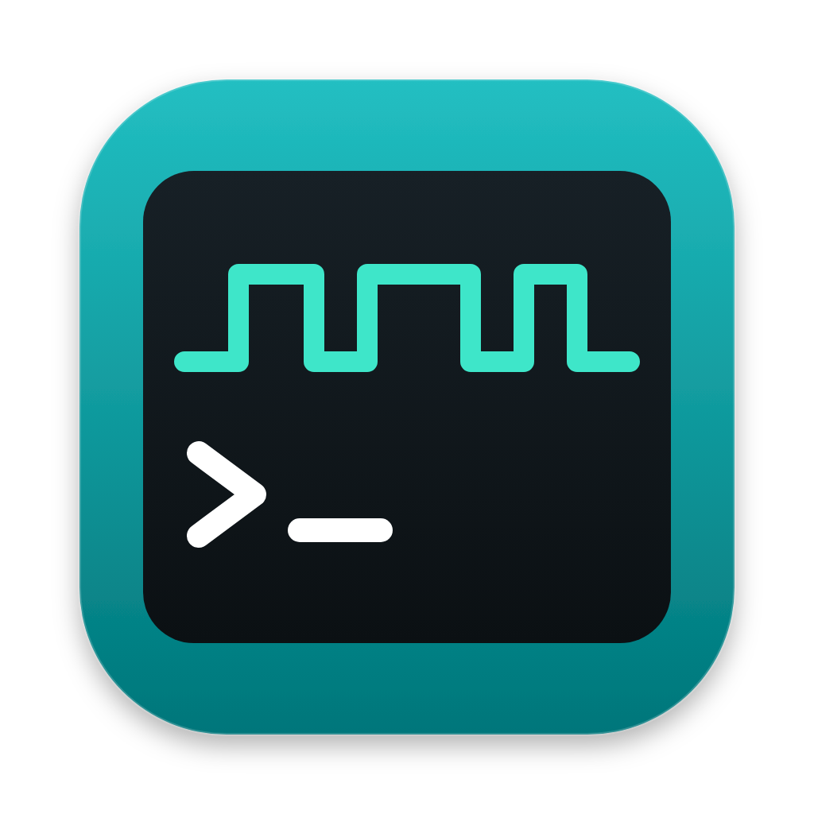
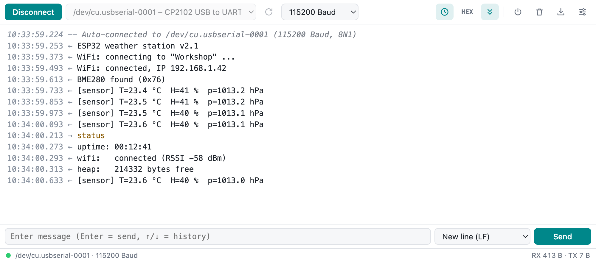
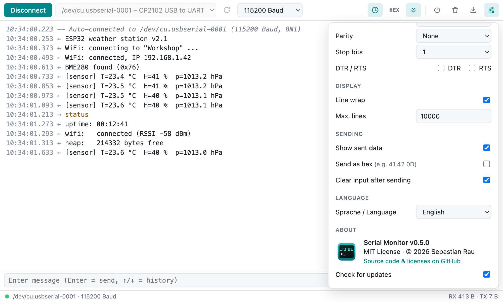
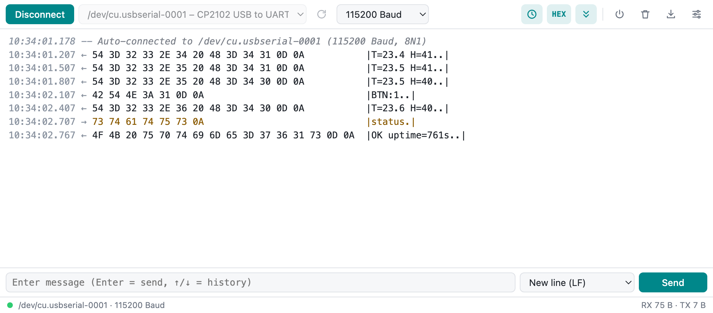

<p align="center">
  
</p>

<h1 align="center">Serial Monitor</h1>

<p align="center">
  A lean serial monitor for macOS, Windows and Linux – in the spirit of the Arduino Serial Monitor.<br>
  <b>English</b> · <a href="README.de.md">Deutsch</a>
</p>

Built with Go and [Wails](https://wails.io). The app uses the web view that ships with the operating system
instead of bundling a browser, so packages are only about 8–11 MB.

<picture>
  <source media="(prefers-color-scheme: dark)" srcset="docs/screenshots/main-dark-en.png">
  
</picture>

## Features

- Port list with real device names (`COM3`, `/dev/cu.usbserial-…`, `/dev/ttyUSB0`)
- Baud rate from a list or any custom value
- Auto-connect to the last used port as soon as it shows up again
- No board reset when connecting; reset button for ESP32/ESP8266 (via RTS) and Arduino (via DTR)
- Timestamps, hex view, autoscroll, save output as a text file
- Line ending on send (none, LF, CR, CR+LF), send as hex, history with ↑/↓
- Update check with direct download of the right package (can be turned off)
- English and German UI, light and dark theme

## Screenshots

<table>
  <tr>
    <td width="50%">
      <picture>
        <source media="(prefers-color-scheme: dark)" srcset="docs/screenshots/settings-dark-en.png">
        
      </picture>
      <p align="center">Settings</p>
    </td>
    <td width="50%">
      <picture>
        <source media="(prefers-color-scheme: dark)" srcset="docs/screenshots/hex-dark-en.png">
        
      </picture>
      <p align="center">Hex view</p>
    </td>
  </tr>
</table>

## Download

Get the packages from **[Releases](https://github.com/sebastianrau/serial-monitor/releases)**:

| System  | File |
|---------|------|
| macOS   | `SerialMonitor-<version>-mac.dmg` (Apple Silicon and Intel, macOS 13 or later) |
| Windows | `SerialMonitor-<version>-windows-x64.exe` or `-arm64.exe` (no installation needed) |
| Linux   | `SerialMonitor-<version>-linux-amd64.tar.gz` or `-arm64.tar.gz` |

Every release also includes `THIRD_PARTY_LICENSES.txt`, one SBOM per operating system in CycloneDX
format (`*.sbom.cdx.json`) and `SHA256SUMS.txt`.

### Notes per system

- **macOS:** The app is only ad-hoc signed – neither signed with an Apple Developer ID nor notarized by Apple –
  so macOS blocks it on first launch. Allow it under *System Settings > Privacy & Security > Open Anyway*
  (since macOS 15, right-click > Open is no longer enough). Or in Terminal:
  `xattr -dr com.apple.quarantine "/Applications/Serial Monitor.app"`
- **Windows:** Needs the WebView2 runtime (preinstalled on Windows 10 and 11) and the driver for your
  board's USB-serial chip (e.g. CH340, CP210x). SmartScreen may warn because the program is not signed.
- **Linux:** Needs `libwebkit2gtk-4.1` and access to serial ports:
  `sudo usermod -aG dialout $USER`, then log out and back in.

## Building

Requires Go (version see `go.mod`). Node.js is not needed.

```bash
./build.sh mac       # dist/Serial Monitor.app + .dmg (Apple Silicon and Intel)
./build.sh windows   # dist/SerialMonitor-<version>-windows-x64.exe and -arm64.exe (works from macOS too)
./build.sh linux     # Linux only, see below
./build.sh all       # everything the current system can build
```

The version comes from the `VERSION` environment variable (default `1.0.0`), e.g. `VERSION=1.2.0 ./build.sh mac`.
For development: `go run -tags desktop,production .`

On Linux (Debian/Ubuntu):

```bash
sudo apt install golang build-essential pkg-config libgtk-3-dev libwebkit2gtk-4.1-dev
./build.sh linux
```

## Releases

Pushing a tag `v*` from `main` builds all packages on GitHub Actions and creates a release:

```bash
git tag v1.2.0
git push origin v1.2.0
```

Tags with a hyphen (e.g. `v1.3.0-beta.1`) and all `0.x` versions are published as pre-releases.
The release notes come from [CHANGELOG.md](CHANGELOG.md). *Actions > Release > Run workflow* builds
everything as a test without publishing a release.

## Project layout

- `main.go` – window and app setup
- `app.go` – serial port (list, open, read, write, DTR/RTS, board reset, save log)
- `update.go` – update check against GitHub Releases
- `frontend/` – UI (`index.html`, `app.js`); also runs standalone in Chrome or Edge via the Web Serial API
- `frontend/i18n.js` – all UI texts in English and German
- `build/` – app icon (`icon.svg` is the source)
- `build.sh` – build script; `scripts/licenses.sh` collects third-party licenses, `scripts/winres` creates
  the Windows icon, manifest and version info
- `.github/workflows/release.yml` – release workflow

Known limitation: hardware flow control (RTS/CTS) is not supported by the Go serial library and is hidden in the app.

## License

[MIT](LICENSE) – free to use, including commercially.
The bundled libraries are under MIT, BSD and Apache 2.0 licenses; their texts are in
`THIRD_PARTY_LICENSES.txt`, which ships with every package.
